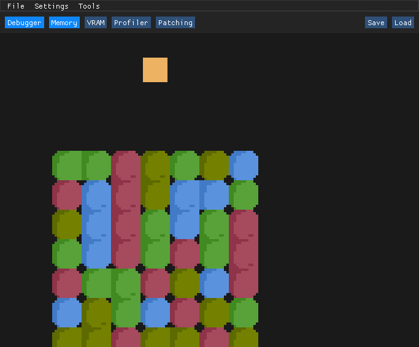
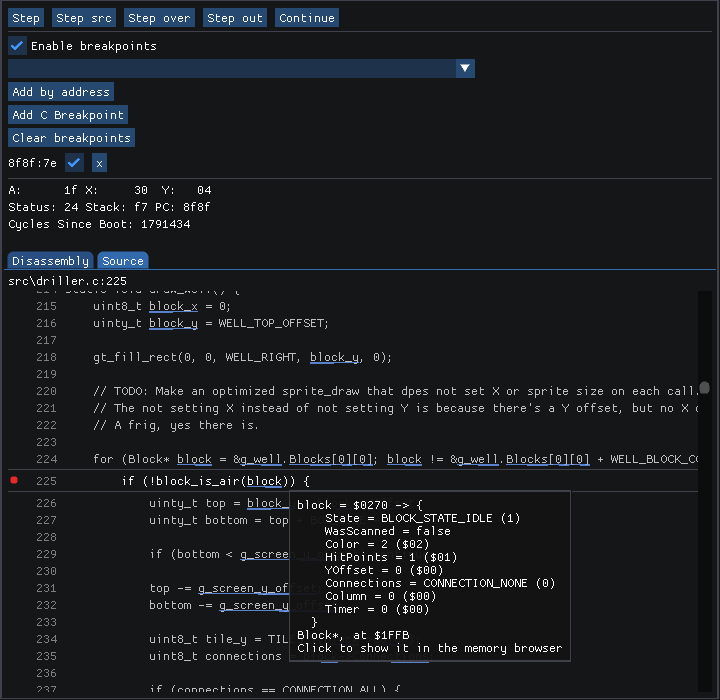
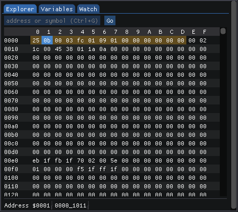

# GameTank Emulator Plus

A fork of [clydeshaffer/GameTankEmulator](https://github.com/clydeshaffer/GameTankEmulator) with more debugging tools. See that repo for how to build and use the emulator.

## Changes

- **Source-level debugging**: Step src, Step over and Step out step by C source line, and run through interrupts.
- **Variable hovers**: hover a variable in the Source tab to see its value. Structs, pointers, enums, bit-fields and array indexes (`g_well.Blocks[y][x]`) all work. Click one to show it in the memory browser. This needs a `variables.dbg` next to the ROM, written from the build's DWARF info.
- **Breakpoints**: click the Source tab's margin to set one. Each one stays on its source line through edits and rebuilds. Click a breakpoint in the list to jump to its code.
- **Memory browser**: go to an address or symbol (Ctrl+G), select and copy bytes (`aa bb cc`), and see the hovered byte's address and binary in a status bar. It remembers where it was scrolled.
- **Save states**: F4 saves, F5 loads (one slot, `<rom>.state`).
- **Ctrl+R** reloads the ROM and its debug files, so a rebuild shows up in the open emulator.
- **Space/Pause** pauses and resumes.
- **Menu bar and toolbar** are always shown.
- **Tool windows** resize and remember their size and position.
- Debug files (`out.map`, `sourcemap.dbg`) are found next to the ROM as well as in `../build`.

